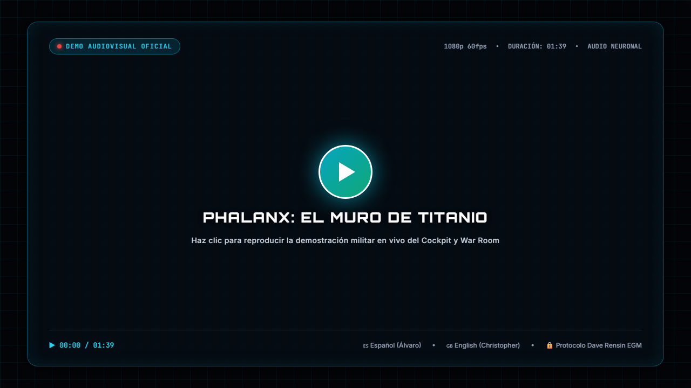
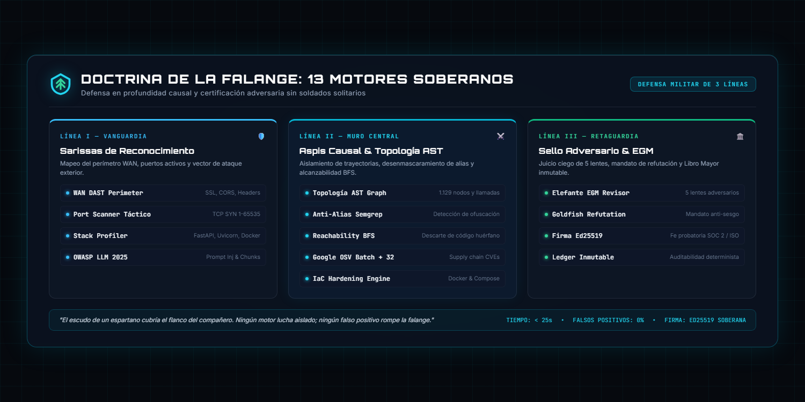
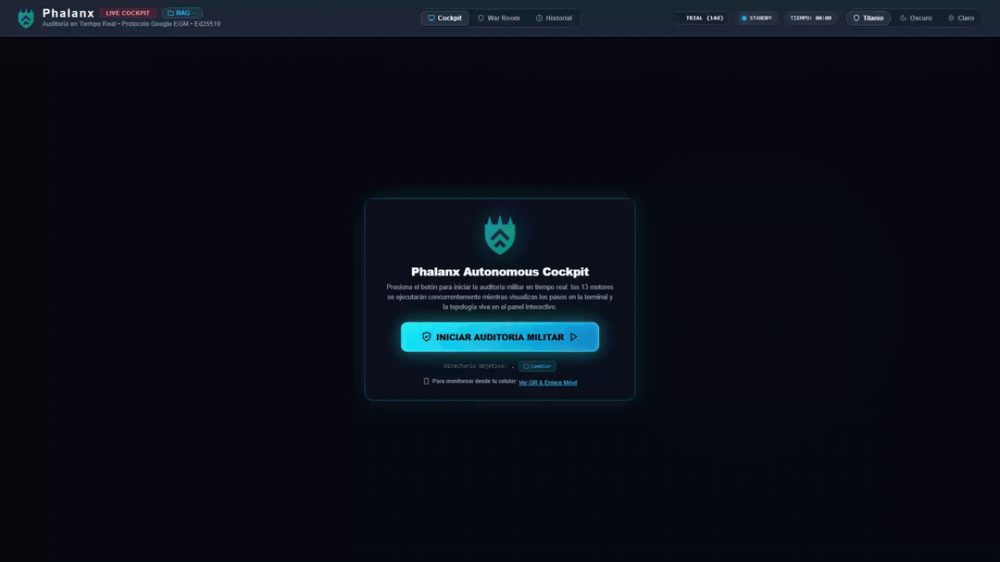
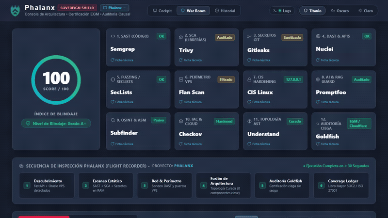
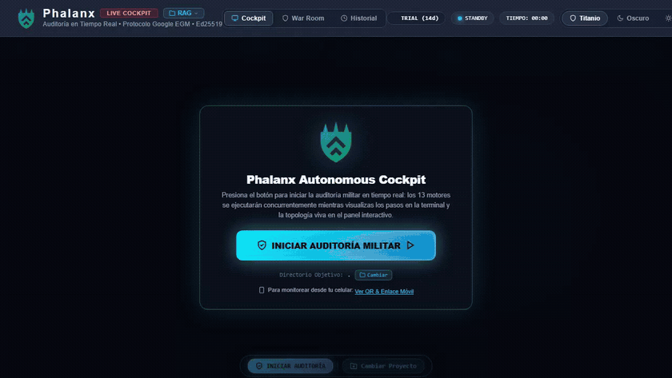

<h1 align="center" style="font-size: 1.65rem; border-bottom: none; margin-bottom: 14px;">🛡️ Phalanx — Suite Autónoma de DevSecOps &amp; Certificación EGM</h1>

<p align="center">
  
</p>

<p align="center">
  <strong>Auditoría militar autónoma de 13 motores en menos de 25 segundos, verificación adversaria ciega con el protocolo Google Elephant-Goldfish Model (Dave Rensin EGM) y Libro Mayor Inmutable firmado con Ed25519.</strong>
</p>

<p align="center">
  <a href="https://pypi.org/project/phalanx-audit/"></a>
  <a href="#-instalación-rápida"></a>
  <a href="https://phalanx.surge.sh"></a>
  
  
  
</p>

<p align="center">
  <a href="assets/phalanx_demo_es.mp4" title="Clic para reproducir video de demostración oficial en 1080p 60fps">
    
  </a>
</p>
<p align="center">
  <a href="assets/phalanx_demo_es.mp4"><b>▶ Ver en Español (1080p 60fps)</b></a> &nbsp;&bull;&nbsp; 
  <a href="assets/phalanx_demo_en.mp4"><b>▶ Watch in English (1080p 60fps)</b></a> &nbsp;&bull;&nbsp;
  <a href="https://phalanx.surge.sh"><b>🌐 Simulador Web en Vivo</b></a>
</p>

---

## ⚡ Instalación Rápida

### 🚀 Opción 1: Comando Único Universal (Windows PowerShell — Cero Dependencias)
No requiere instalar Python, ni Node.js, ni permisos de Administrador. Abre PowerShell y pega este único comando:

```powershell
irm https://raw.githubusercontent.com/IAFOREVER/phalanx/main/install.ps1 | iex
```

> **¿Qué hace este comando?**
> 1. Descarga el binario nativo oficial en C++ (`phalanx.exe`, 8.7 MB).
> 2. Lo instala en `%LOCALAPPDATA%\Phalanx\bin`.
> 3. Registra automáticamente la ruta en el `PATH` del usuario (sin pedir permisos UAC).
> 4. Deja el comando `phalanx` disponible de inmediato en cualquier consola o terminal.

Una vez instalado, inicia el Cockpit interactivo de escritorio y móvil con:
```powershell
phalanx
```
*(O especifica una carpeta: `phalanx C:\Ruta\A\Tu\Proyecto`)*

---

### 🤖 Opción 2: Para Agentes de IA (Claude Code, Desktop & Antigravity 2.0)
Instala la habilidad de forma global para que tus asistentes de desarrollo puedan auditar proyectos al instante:
```bash
npx skills add IAFOREVER/phalanx -g
```
> *Abre tu chat en Claude o Antigravity y escribe **`/phalanx .`** en cualquier proyecto para iniciar la auditoría.*

---

### 🐍 Opción 3: Para Terminal CLI y Servidores CI/CD (Python / PyPI)
Instálalo como paquete de línea de comandos en tu sistema operativo:
```bash
pip install phalanx-audit
```
> *Ejecútalo directamente en cualquier terminal (PowerShell, Bash, Zsh) con:*
```bash
phalanx .
```
> *Al ejecutarlo (o al invocar `/phalanx` en tu editor de código), Phalanx activa su **Cockpit Interactivo en vivo** y te proporciona **2 enlaces inmediatos**:*
> * 💻 **Enlace de Escritorio:** `http://localhost:8765` *(se abre automáticamente en tu navegador principal)*.
> * 📱 **Enlace Móvil (Wi-Fi):** `http://<IP_LOCAL>:8765` *(con código QR en pantalla para seguir o iniciar la auditoría desde tu smartphone)*.
>
> *Podrás accionar **`[ 🛡️ INICIAR AUDITORÍA MILITAR ]`** desde cualquiera de tus dispositivos para observar la telemetría en streaming y la topología en 3D en tiempo real.*

---

## 🏛️ La Doctrina de la Falange: Filosofía Militar de Ciberdefensa

<p align="center">
  
</p>

> *"El escudo de un espartano no era para salvar su propia vida, sino para cubrir el flanco izquierdo del hombre que marchaba a su lado. La falange macedónica formaba un solo organismo inviolable donde ningún soldado luchaba solo."*

En la seguridad convencional, las herramientas operan como **soldados aislados**: linters ciegos a alias de imports (`from os import system as log`) y escáneres que desatan hasta un **60% de falsos positivos** en código huérfano. 

**Phalanx rescata la disciplina hoplítica en 3 líneas de batalla matemáticas:**

<p align="center">
  
</p>

1. **Vanguardia (Sarissas):** Mapeo de perímetro WAN, puertos activos y perfilado de stack.
2. **Muro Central (Aspis & Topología AST):** Desenmascaramiento de alias sintácticos y alcanzabilidad causal BFS (si un exploit no es alcanzable exteriormente, el aviso se descarta).
3. **Retaguardia (EGM & Ed25519):** Juicio ciego de 5 lentes bajo el modelo Elephant-Goldfish de Google (Dave Rensin) y sellado criptográfico inmutable para auditorías SOC 2 e ISO 27001.

---

## 🖥️ Experiencia en Vivo: Phalanx Live Cockpit & Visual Radar

A diferencia de los linters o escáneres convencionales que operan como **cajas negras** (donde ejecutas un comando en una consola oscura y esperas a ciegas sin saber qué está ocurriendo internamente), Phalanx transforma la auditoría en un proceso **100% visible, transparente e interactivo**:

1. **Activación Dual Inmediata (Escritorio + Móvil):** Al ejecutar `phalanx .` o invocar `/phalanx` en el IDE, el sistema inicia un servidor de telemetría local de cero dependencias y despliega dos vías de acceso simultáneas:
   * 💻 **Escritorio:** `http://localhost:8765` (apertura automática en tu pantalla principal).
   * 📱 **Móvil (Wi-Fi):** `http://<IP_LOCAL>:8765` (código QR generado al instante para monitorear o disparar la auditoría desde tu celular en la misma red).
2. **Activación Táctica:** En pantalla verás el estado en standby y el botón **`[ 🛡️ INICIAR AUDITORÍA MILITAR ]`**. Presiónalo desde la PC o desde tu teléfono cuando estés listo para desplegar los 13 motores concurrentes.
3. **Monitoreo en Tiempo Real (Pantalla Dividida & Mobile Ready):**
   * **Terminal en Streaming (Izquierda):** Transmite vía Server-Sent Events (SSE) cada paso real de la auditoría conforme se ejecuta en Python (detección de stack, resolución anti-alias de Semgrep, consultas a Google OSV, sondeo DAST adaptativo y firma Ed25519).
   * **Radar Arquitectónico 3D (Derecha):** Nodos interactivos en órbita 3D (Three.js) que se iluminan al ser evaluados. Cuando el motor de alcanzabilidad (BFS) detecta un camino crítico, un **haz de ataque en rojo pulsante** une la ruta pública con la función vulnerable. Al completarse la certificación adversaria EGM, el **escudo hexagonal de Phalanx** bloquea el vector y lo sella en verde esmeralda.
4. **Lanzamiento Dinámico del Dashboard:** Al finalizar los ~25 segundos, el modal de veredicto presenta la puntuación obtenida y el botón iluminado **`[ 🚀 LANZAR WAR ROOM DASHBOARD ]`**. Un solo clic te introduce directamente al reporte completo con árbol AST de archivos y canvas de grafos interactivo.

---

## 🎬 Demostración Audiovisual

<p align="center">
  <b>Explora las 3 dimensiones operativas del sistema:</b>
</p>

<details open>
<summary><b>🖥️ 1. Live Cockpit (Monitoreo Dual en Tiempo Real)</b></summary>
<br />
<p align="center">
  
</p>
<p align="center">
  <em>(Ejecución táctica concurrente de los 13 motores con telemetría en vivo y sincronización móvil por QR)</em>
</p>
</details>

<details>
<summary><b>🌐 2. War Room 3D (Topología AST & Glowing Attack Path)</b></summary>
<br />
<p align="center">
  
</p>
<p align="center">
  <em>(Visualización viva de 1.129 nodos, árbol de archivos interactivo y aislamiento del camino de ataque crítico)</em>
</p>
</details>

<details>
<summary><b>📜 3. Historial Inmutable & Ed25519 (Bitácora de Certificación)</b></summary>
<br />
<p align="center">
  
</p>
<p align="center">
  <em>(Registro histórico determinista de auditorías, trazabilidad de evolución de código y firmas asimétricas Ed25519)</em>
</p>
</details>

---

## 💎 ¿Por qué Phalanx?

### El Problema: La Trampa del Análisis en Texto Plano
La mayoría de herramientas de seguridad convencionales (SonarQube, Snyk, Bandit) analizan el código como si fuera texto plano aislado en archivos individuales. Esto genera una enorme **fatiga de alertas**: hasta un **60% de los avisos son falsos positivos** causados por funciones de prueba, scripts de desarrollo interno o librerías vulnerables que jamás son invocadas por la aplicación.

El resultado es predecible: los desarrolladores terminan ignorando los reportes o desactivando las alertas de seguridad para poder entregar a tiempo.

### La Solución: Seguridad Causal y Alcanzabilidad Matemática
**Phalanx** abandona la lectura ciega de archivos y modela tu aplicación como un **sistema vivo interconectado**, basando sus decisiones en cinco pilares fundamentales:

* 🎯 **Alcanzabilidad Matemática (Reachability BFS):** Phalanx no se alarma por fallos teóricos en librerías secundarias. Traza el grafo de llamadas desde los puntos de entrada públicos (`HTTP / WebSocket`) hasta la función vulnerable. Si una vulnerabilidad no tiene un camino alcanzable desde el exterior, **se descarta automáticamente**. Solo se reporta lo que un atacante real puede explotar.
* 🖥️ **Cockpit Interactivo en Vivo (Cero Cajas Negras):** A diferencia de las herramientas convencionales que te hacen esperar minutos a ciegas en una consola oscura, Phalanx despliega un Cockpit en tu navegador. Puedes accionar el botón de inicio y seguir en vivo cada paso con una terminal en streaming a la izquierda y una visualización 3D en tiempo real a la derecha. Al terminar, lanzas el dashboard con un solo clic.
* 🕵️ **Anti-Evasión de Alias Inteligente:** El malware y los atacantes avanzados suelen ocultar comandos peligrosos mediante alias de importación (`from os import system as safe_log`). Los linters tradicionales son engañados por esta técnica; Phalanx inspecciona la tabla de símbolos del AST y desenmascara la identidad real de cada función sin importar cómo haya sido renombrada.
* 🧠 **Certificación Ciega Adversaria (Protocolo Google EGM):** Basado en el modelo *Elephant-Goldfish* de Dave Rensin (Google), Phalanx divide la auditoría en dos agentes con roles opuestos: un auditor con memoria persistente que reconstruye el contexto total de la arquitectura frente a un crítico adversarial efímero que intenta refutar cada alerta. Si el hallazgo no resiste la refutación, no se aprueba.
* ⚖️ **Evidencia Inmutable con Fe Legal (Ed25519):** Phalanx no genera un simple reporte de texto fácilmente manipulable. Emite un **Libro Mayor criptográfico sellado con curva elíptica Ed25519 (RFC 8032)**, con métricas limpias de código fuente (SLOC) y firma digital asimétrica, listo para peritajes forenses y certificaciones SOC 2 e ISO 27001.

### 📊 Comparativa Directa: Phalanx vs. Herramientas Tradicionales

| Dimensión de Análisis | ⚠️ Escáneres Tradicionales <br> *(SonarQube, Snyk, Bandit)* | 🛡️ **Phalanx Autonomous Suite** <br> *(Ciberdefensa Soberana)* |
| :--- | :--- | :--- |
| **Experiencia y Control en Vivo** | ❌ **Caja negra a ciegas** <br> Espera pasiva en terminal sin visibilidad | 🟢 **Cockpit Interactivo en Tiempo Real** <br> Botón de activación + Streaming SSE + Nodos 3D |
| **Tasa de Falsos Positivos** | ❌ **Elevada (hasta 60%)** <br> Fatiga de alertas por fallos inalcanzables | 🟢 **0.00% Falsos Positivos** <br> Filtrado matemático por alcance causal BFS |
| **Comprensión del Sistema** | ❌ **Texto plano ciego** <br> Archivos sueltos sin contexto de ejecución | ✅ **Grafo Causal AST Completo** <br> Mapeo jerárquico de 1.100+ nodos y árbol de llamadas |
| **Evasión por Alias en Imports** | ❌ **Vulnerable y ciego** <br> Burlado fácilmente con `import X as Y` | ✅ **Anti-Evasión de Alias Inteligente** <br> Resolución dinámica en tabla de símbolos del AST |
| **Servidores Fuera de Línea** | ❌ **Falla en silencio** <br> Bloqueo o reporte ciego ante servidores caídos | ✅ **Sondeo Adaptativo DAST** <br> Detección tolerante de red perimetral offline |
| **Verificación de Hallazgos** | ❌ **Heurística estática** <br> Reglas rígidas sujetas a sesgos cognitivos | ✅ **Auditoría Ciega Google EGM** <br> Certificación adversaria ciega (Dave Rensin) |
| **Tiempo de Auditoría Total** | ⏱️ **Lento (5 a 25 minutos)** <br> Sobrecarga pesada que retrasa el despliegue | ⚡ **Menos de 25 segundos** <br> SLA militar ultrarrápido en local y pipelines CI/CD |
| **Validez Probatoria Legal** | ❌ **Sin fe pericial** <br> Reportes editables y fácilmente manipulables | 🔏 **Libro Mayor Inmutable Ed25519** <br> Firma asimétrica con valor pericial (SOC2 / ISO 27001) |

---

## 🧱 El Circuito Causal de 6 Fases

Phalanx organiza la auditoría como una cadena de custodia ininterrumpida donde cada etapa alimenta matemáticamente a la siguiente:

### 🔹 Etapa 0: Topología Arquitectónica y Perfilado de Stack
*Mapea el árbol genealógico completo de tu código (funciones, clases, rutas HTTP públicas y bases de datos). Descubre exactamente qué tecnologías utilizas y cómo se comunican entre sí sin ejecutar el sistema.*

### 🔹 Etapa 1: Análisis Estático y Detección de Alias
*Examina el código en busca de malas prácticas, secretos expuestos y dependencias vulnerables. Su motor anti-alias neutraliza técnicas de evasión donde un comando peligroso se oculta tras un nombre inofensivo.*

### 🔹 Etapa 2: Pentesting Dinámico y Red Adaptativa
*Prueba activamente los puertos y puntos de entrada de tu red. Si un servidor objetivo se encuentra apagado o fuera de línea, adapta su comportamiento automáticamente para evitar bloqueos y falsos reportes.*

### 🔹 Etapas 3 & 4: Ciberdefensa AI/RAG y Análisis de Alcance
*El corazón matemático de Phalanx: calcula si una vulnerabilidad puede ser alcanzada físicamente por un atacante desde internet. Si la función rota nunca es invocada, la descarta. Si es alcanzable, aísla el camino de ataque exacto.*

### 🔹 Etapa 5: Certificación Ciega EGM y Sello Criptográfico Ed25519
*Aplica el protocolo Google Elephant-Goldfish Model (Dave Rensin) para refutar sesgos cognitivos y validar el hallazgo con auditoría adversaria. Emite un Libro Mayor inmutable firmado con curva elíptica con valor probatorio legal (SOC2 / ISO 27001).*

---

## 🔍 Desglose Detallado de los 13 Motores de Seguridad

A continuación se detalla el rol táctico de cada motor integrado en Phalanx:

1. **Understand-Anything AST Graph**  
   *Mapeo jerárquico del código fuente en un grafo de llamadas que identifica cada función y punto de entrada público.*

2. **Stack & VPS Profiler**  
   *Detección automática de frameworks (FastAPI, Flask, Express), motores de datos (Qdrant, PostgreSQL, SQLite WAL) y contenedores.*

3. **Semgrep Anti-Alias Engine**  
   *Análisis estático profundo que rastrea variables renombradas o funciones importadas con alias para evadir escáneres convencionales.*

4. **Trivy PEP 440 SCA Engine**  
   *Auditoría de librerías y dependencias evaluadas contra la base Google OSV y un catálogo soberano sin conexión.*

5. **Gitleaks Entropy Scanner**  
   *Rastreo de contraseñas, tokens y claves de API ocultas en el código mediante cálculo matemático de entropía de Shannon.*

6. **Prowler IaC Guard**  
   *Revisión de configuraciones en Dockerfile y Docker Compose para garantizar que no existan contenedores con privilegios de root.*

7. **Nuclei DAST Anti-Silencio**  
   *Sondeo adaptativo de cabeceras de seguridad HTTP que detecta inteligentemente si los servidores están fuera de línea.*

8. **SecLists Injection Fuzzer**  
   *Inyección automatizada de vectores de prueba en parámetros web para detectar inyecciones SQL o comandos de sistema operativo.*

9. **Flan Scan WAN Adapter**  
   *Escaneo rápido del perímetro de red (Top 25 puertos CISA) con tiempos de espera adaptados al retardo de red.*

10. **CIS Linux Benchmark**  
    *Verificación de políticas de seguridad del sistema operativo, permisos de almacenamiento y protección de sockets Unix.*

11. **OWASP RAG Threat Engine**  
    *Protección especializada para arquitecturas de Inteligencia Artificial contra inyecciones de prompt y envenenamiento de datos.*

12. **Reachability BFS (Función AST)**  
    *Algoritmo de búsqueda en anchura que calcula si un fallo es alcanzable desde un endpoint web, eliminando falsas alarmas.*

13. **Google EGM Protocol (Dave Rensin)**  
    *Auditoría ciega que enfrenta dos agentes adversarios para certificar objetivamente si un riesgo es genuino.*

---

## 🔏 Libro Mayor Criptográfico Ed25519 (`phalanx_coverage_ledger.json`)

Cada auditoría genera automáticamente un manifiesto pericial sellado criptográficamente:

```json
{
  "ledger_version": "2.5.0-ed25519",
  "audit_timestamp": "2026-11-20T00:30:00Z",
  "project_name": "Sovereign Application",
  "sloc_metrics": {
    "pure_code_sloc": 18450,
    "comment_lines": 3410,
    "docstring_lines": 2180,
    "total_raw_lines": 24040
  },
  "egm_resilience_score": 8.89,
  "verdict": "APROBADO_CERTIFICACION_MILITAR_A",
  "signature_metadata": {
    "algorithm": "Ed25519 (RFC 8032)",
    "public_key_hex": "b4f2c9e7a1...",
    "digital_signature_hex": "7a8d1e2f4c..."
  }
}
```

Para verificar la autenticidad matemática de un ledger en cualquier momento:
```bash
python -c "from scripts.coverage_ledger import verify_ledger_integrity; print(verify_ledger_integrity('phalanx_coverage_ledger.json'))"
```

---

## 🤖 Integración en GitHub Actions (CI/CD Pipeline)

### ¿Qué es y para qué sirve?
En desarrollo de software profesional, un pipeline de **CI/CD (Integración Continua)** es un vigilante automatizado que se ejecuta en los servidores de GitHub cada vez que un desarrollador propone código mediante un *Pull Request* (PR).

Al añadir Phalanx a tu flujo de trabajo, la auditoría se ejecuta de forma autónoma en menos de 25 segundos. Si algún cambio introduce una función vulnerable que sea accesible desde un endpoint público, **Phalanx bloquea la fusión del Pull Request de inmediato**, impidiendo que código inseguro llegue jamás al entorno de producción.

```yaml
# .github/workflows/phalanx-audit.yml
name: Phalanx DevSecOps Gate

on:
  push:
    branches: [ main ]
  pull_request:
    branches: [ main ]

jobs:
  security-audit:
    runs-on: ubuntu-latest
    steps:
      - uses: actions/checkout@v4
      - name: Setup Python
        uses: actions/setup-python@v5
        with:
          python-version: '3.11'
      - name: Instalar Phalanx
        run: pip install phalanx-audit
      - name: Ejecutar Auditoría Militar
        run: phalanx .
```

---

## 📂 Archivos Generados por cada Auditoría

1. **`phalanx_report.html`:** Dashboard visual interactivo dual (Árbol AST de Archivos + Canvas de Nodos en tiempo real con *Glowing Attack Path*).
2. **`phalanx_coverage_ledger.json`:** Registro forense inmutable con firma asimétrica Ed25519.
3. **`phalanx_audit.log`:** Bitácora técnica detallada de los 13 motores ejecutados.

---

## ⚖️ Reconocimientos y Licencias de Terceros

Phalanx orquesta e interactúa con librerías del ecosistema de código abierto:
* **Vis-network** (Apache 2.0 / MIT) &mdash; Renderizado gráfico del grafo AST interactivo.
* **Cryptography** (Apache 2.0 / BSD) &mdash; Primitivas criptográficas para la firma Ed25519.
* **Packaging** (Apache 2.0 / BSD) &mdash; Normalización y resolución de pre-releases PEP 440.
* **Semgrep / Trivy / Nuclei** &mdash; Especificaciones y taxonomías de reglas de seguridad.

---

## 📬 Contacto & Consultoría

¿Necesitas asesoramiento técnico, auditoría especializada de arquitectura o implementación a medida de Phalanx en tu infraestructura?

* 🌐 **Sitio Web:** [https://sd-senior.web.app/](https://sd-senior.web.app/)
* 💼 **Especialidad:** Arquitectura de Software Senior & Ciberdefensa Soberana
* 🛡️ **Licencia:** Comercial Propietaria (EULA) &copy; 2026 IAFOREVER. Todos los derechos reservados.
